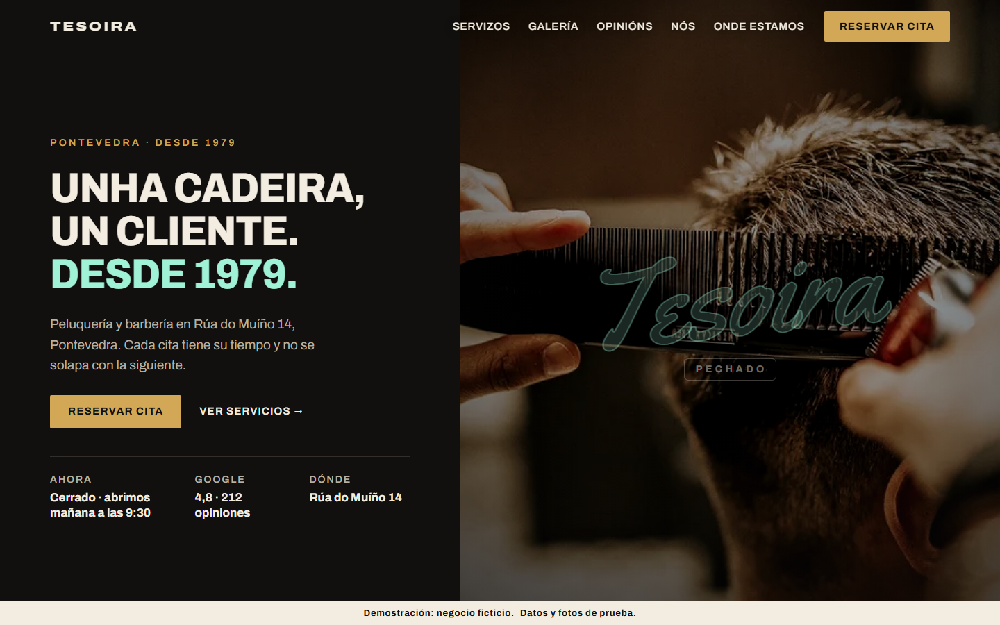

# Tesoira Estudio de Pelo

[English](#en) | [Español](#es) | [Live demo](https://taupe-bombolone-662721.netlify.app)



<a id="en"></a>

## English

Demo website for **Tesoira**, a fictional hair salon and barber shop in Pontevedra (Galicia). The business, prices, reviews and contact details are made up so I could test the whole process of building a real website for a local business.

I built it with Claude Code and my own skill, [web-peluquerIA](https://github.com/pereztierradaniel-code), which guides the AI step by step: business brief, style, sections, booking, legal pages and checks.

### What it does
- **Neon sign that knows the opening hours.** It lights up when the salon is open and switches to "closed" outside working hours and on public holidays (worked out by rule, so they don't expire).
- **Price ticket.** You pick services and the ticket adds up the total price and time.
- **Demo booking in 6 steps:** services, stylist, day, time, your details and a summary that prepares a WhatsApp message. It's in demo mode, so nothing actually gets sent.
- Gallery, reviews, team and a map that only loads when you click it (no external requests before that).
- Galician headlines and Spanish body text, responsive from phones to desktop.

### Quality
I didn't want a site that only looks good in one browser, so I tested it like a real project:

| Check | Result |
|---|---|
| Logic tests (`npm test`) | 38 / 38 |
| Browser tests with Playwright: iPhone, Android, Safari, Chrome and Firefox at 4 different times of day | 40 / 40 |
| HTML validation | 0 errors |
| Broken links | 0 of 38 |
| Content Security Policy | 0 blocked resources |

Details in [COMPROBACIONES.md](COMPROBACIONES.md) (Spanish).

### Run it
```bash
npm run serve        # opens the site at http://127.0.0.1:5511
npm test             # logic tests (Node 20+)
npm install && npx playwright install && npm run test:e2e   # browser tests
```

### Stack
HTML, CSS and plain JavaScript (no framework), Node test runner, Playwright, Netlify.

### Credits
Placeholder photos from Wikimedia Commons under CC BY 2.0, CC BY-SA 4.0 and public domain. Authors and licences are in [CREDITS.json](CREDITS.json) and in the site footer.

---

<a id="es"></a>

## Español

Web de demostración de **Tesoira**, una peluquería y barbería ficticia de Pontevedra. El negocio, los precios, las reseñas y los datos de contacto son inventados para probar todo el proceso de crear una web real para un negocio local.

La hice con Claude Code y mi propia skill, [web-peluquerIA](https://github.com/pereztierradaniel-code), que guía a la IA paso a paso: ficha del negocio, estilo, secciones, reservas, textos legales y comprobaciones.

### Qué hace
- **Neón que sabe el horario.** Se enciende cuando la peluquería está abierta y cambia a «cerrado» fuera de horario y en festivos (calculados por regla, así que no caducan).
- **Ticket de precios.** Eliges servicios y el ticket suma el precio y el tiempo total.
- **Reserva de demostración en 6 pasos:** servicios, profesional, día, hora, tus datos y un resumen que prepara el mensaje de WhatsApp. Va en modo demostración, así que no se envía nada.
- Galería, reseñas, equipo y un mapa que solo se carga al pulsarlo (antes no hay peticiones externas).
- Titulares en gallego y textos en español, adaptada del móvil al ordenador.

### Calidad
No quería una web que solo se viera bien en un navegador, así que la probé como un proyecto real:

| Comprobación | Resultado |
|---|---|
| Pruebas de lógica (`npm test`) | 38 / 38 |
| Pruebas en navegadores con Playwright: iPhone, Android, Safari, Chrome y Firefox a 4 horas distintas | 40 / 40 |
| Validación del HTML | 0 errores |
| Enlaces rotos | 0 de 38 |
| Política de seguridad de contenidos (CSP) | 0 recursos bloqueados |

El detalle está en [COMPROBACIONES.md](COMPROBACIONES.md).

### Cómo probarla
```bash
npm run serve        # abre la web en http://127.0.0.1:5511
npm test             # pruebas de lógica (Node 20 o superior)
npm install && npx playwright install && npm run test:e2e   # pruebas en navegadores
```

### Tecnologías
HTML, CSS y JavaScript sin frameworks, el ejecutor de pruebas de Node, Playwright y Netlify.

### Créditos
Fotos provisionales de Wikimedia Commons con licencias CC BY 2.0, CC BY-SA 4.0 y dominio público. Los autores y las licencias están en [CREDITS.json](CREDITS.json) y en el pie de la web.


